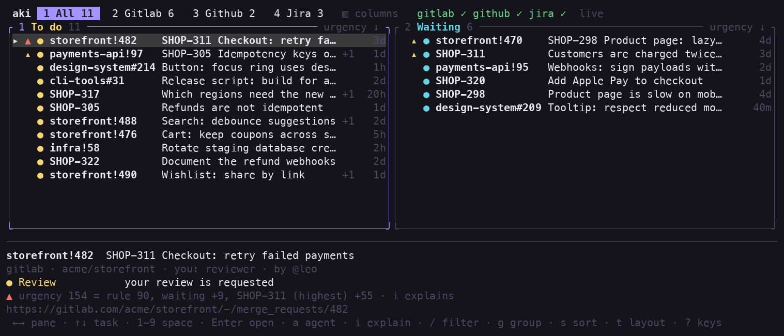

# aki

*À qui ?* — French for "whose turn?".

On a team, every merge request and every ticket is waiting on someone.
**aki** reads GitLab, GitHub and Jira and puts it all on one board, in your
terminal: what is waiting on **you**, and what you are waiting on **others**
for.


**[Website](https://nathan-poncet.github.io/aki/)** ·
**[Quick start](https://nathan-poncet.github.io/aki/quick-start.html)** ·
**[Documentation](https://nathan-poncet.github.io/aki/install.html)**

## What it does

- **To do**: the next move is yours. A review you were asked for, a thread
  waiting for your answer, a pipeline of yours that broke, a change that is
  approved and ready to merge.
- **Waiting**: you cannot move it further. It says who you are waiting on,
  and for how long.

When a teammate answers, the task changes side by itself, and you get a
notification.



aki only reads your sources. It never approves, merges, comments or pushes.

## Install

```sh
curl -fsSL https://nathan-poncet.github.io/aki/install.sh | sh
```

Or with Cargo:

```sh
cargo install --locked --git https://github.com/nathan-poncet/aki
```

macOS and Linux. [Other ways to install](https://nathan-poncet.github.io/aki/install.html).

## Use

aki signs in with the tools you already have: `glab` for GitLab, `gh` for
GitHub. Jira takes [three lines of configuration](https://nathan-poncet.github.io/aki/sources.html).

```sh
glab auth login       # or: gh auth login
aki                   # the live board
```

On the board, `Enter` opens a task in the browser, `i` explains why it is
there, `/` filters, and `?` lists every key.

```sh
aki list              # print the board once: --todo, --waiting, --json, --count
aki agent web!916     # open your coding agent on a task
aki mcp setup         # plug the board into Claude
aki doctor            # check every source
aki config init       # write the configuration file, with every default
```

## What you can do with it

| | |
|---|---|
| [Know what comes first](https://nathan-poncet.github.io/aki/urgency.html) | Every task has an urgency score, and `i` shows how it adds up: the rule, how long it has waited, the ticket behind it. |
| [Hand a task to a coding agent](https://nathan-poncet.github.io/aki/agents.html) | `a` opens Claude Code (or any agent) in the right clone, already briefed. It opens in tmux, Herdr or TUIOS when aki runs in one, in a session or workspace per repository. |
| [Ask Claude instead](https://nathan-poncet.github.io/aki/assistants.html) | `aki mcp` serves the board to Claude Desktop, Claude Code or any MCP client: "who is waiting on me?" |
| [Set a task aside](https://nathan-poncet.github.io/aki/set-aside.html) | `p` hides a task until tomorrow, for some days, or until it moves. |
| [Arrange the board](https://nathan-poncet.github.io/aki/spaces.html) | Spaces (work, personal, a project), tiled panes, [filters](https://nathan-poncet.github.io/aki/filters.html), groups and orders. |
| [Change the rules](https://nathan-poncet.github.io/aki/rules.html) | 21 rules decide whose move it is. Each can be turned off, moved to the other side, or weighed differently. |
| [Configure it](https://nathan-poncet.github.io/aki/configuration.html) | One TOML file. [`config/example.toml`](config/example.toml) documents every key. |

## Good to know

- "Live" means the board looks again every 30 seconds. What it reads is
  cached in one local file, so a refresh is a handful of light requests.
- Nothing leaves your machine: no account, no server. Tokens are read from
  an environment variable or a command, never stored.
- Jira Cloud only, and a few other [known limits](LIMITS.md).

## Contributing

aki is written in Rust. [CONTRIBUTING.md](CONTRIBUTING.md) says how to
build, test and add a source or a multiplexer;
[ARCHITECTURE.md](ARCHITECTURE.md) says how the code is laid out.

## License

[GPL-3.0-or-later](LICENSE): you can use, study, modify and share aki,
commercially or not; if you distribute it, modified or not, you do so under
the same license, with the source. For a license under other terms, contact
the author.
